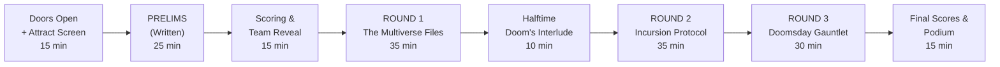
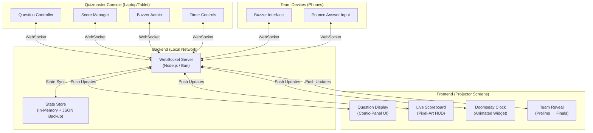
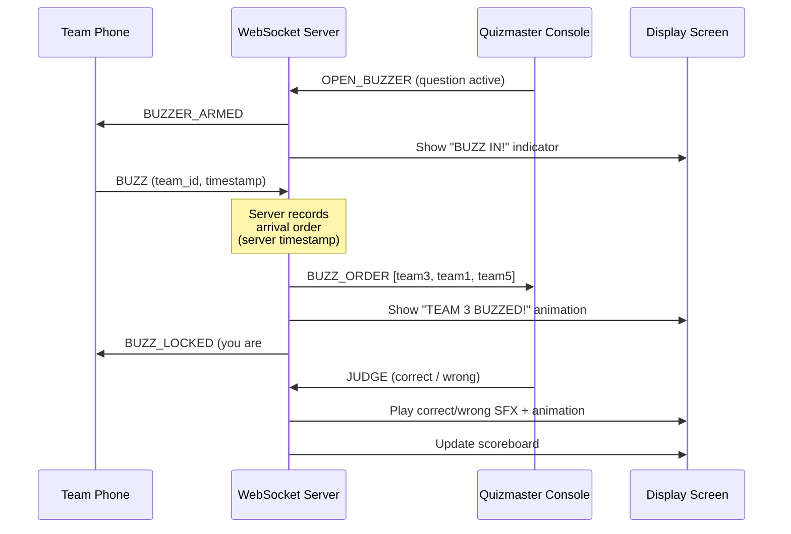
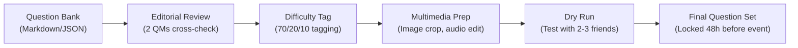

# 🔥 ROAD TO DOOMSDAY — Architecture & Implementation Plan

> A Marvel-themed open quiz event for the Quizzing Club, dripping in retro comic-book ink and 16-bit console nostalgia.

---

## Design References

````carousel

<!-- slide -->

````

> [!NOTE]
> **What we extract from these references:**
> Heavy black outlines, Ben-Day halftone dot patterns, saturated primary palette (scarlet, gold, cobalt, jade), expressive hand-lettered typography, speech-bubble UI chrome, and "RetroVision Variant" CRT scanline textures. The console-game layer adds pixel-art HUD elements, 8-bit SFX, and an arcade "INSERT COIN" attract-screen sensibility.

---

## 1 — Event Identity & Theme

### 1.1 Narrative Concept

| Element | Decision | Rationale |
|---|---|---|
| **Title** | *Road to Doomsday* | Directly references the MCU *Avengers: Doomsday* hype, creating instant cultural hook and anticipation. |
| **Narrative wrapper** | Teams are **multiversal factions** assembling champions across dimensions to prevent an Incursion. Each quiz round is a "mission" along the Road. | Gives the event a storyline arc — not just disconnected rounds — and lets you brand each round with its own comic-issue identity. |
| **Tone** | Dramatic but playful. Think Stan Lee narration boxes meets arcade cabinet attract screens. | Keeps it accessible (non-fans still understand "cool comic-book quiz") while rewarding superfans with Easter eggs. |
| **Villain / Stakes** | Doctor Doom. Each wrong answer or penalty visually advances a **Doomsday Clock** on screen. | Provides a unifying antagonist, creates tension, and gives Tech & Data a gorgeous visual mechanic to build. |

### 1.2 Visual Identity System

| Layer | Specification | Rationale |
|---|---|---|
| **Primary palette** | `#C41230` (Crimson), `#F5C518` (Gold/IMDB Gold), `#1A1A2E` (Void Black), `#FAFAFA` (Panel White) | Directly pulled from the Magik and X-Men covers: high-contrast, ink-on-newsprint primaries that read at distance on a projector. |
| **Accent palette** | `#2D6A4F` (Doom Green), `#3A86FF` (Cosmic Blue), `#9B5DE5` (Multiverse Purple) | Each accent maps to a thematic element (Doom, Cosmic rounds, Multiverse mechanics) keeping visual wayfinding intuitive. |
| **Typography** | Display: *Bangers* or *Comic Neue* (free Google Fonts, comic-lettering feel). Body: *Space Mono* (monospace, console-game HUD). | Avoids licensing issues while nailing the retro comic + console crossover aesthetic. Both render well on projectors. |
| **Texture overlays** | Ben-Day halftone dots at 15% opacity, CRT scanline SVG filter, torn-paper panel edges | Sells the "RetroVision Variant" look from your Magik reference without being so heavy it hurts readability. |
| **UI chrome** | Speech-bubble containers for question text, Kirby Krackle energy borders for timers, pixel-art health bars for scoring | Blends the two reference worlds (comics + console) into a unified interaction language. |

### 1.3 Audio Identity

| Element | Specification | Rationale |
|---|---|---|
| **Walk-in / attract loop** | Chiptune arrangement of a dramatic Marvel motif (original 8-bit composition or royalty-free equivalent) | Sets the atmosphere the moment participants walk in. Chiptune bridges the console-game aesthetic. |
| **Buzzer SFX** | Retro arcade "PLAYER SELECT" chime, distinct per team slot | Instant feedback, reinforces the console theme, helps the QM identify who buzzed without looking at the screen. |
| **Correct answer** | 16-bit "level up" fanfare (short, 2 seconds) | Celebratory without eating into time. |
| **Wrong answer / penalty** | Doom laugh sample + CRT static burst (short, 1.5 seconds) | Thematic punishment that gets genuine laughs from the audience. |
| **Doomsday Clock tick** | Low rumble + ticking clock, escalating BPM as clock advances | Builds organic tension without the QM having to narrate it. |

---

## 2 — Quiz Format Architecture

### 2.1 Timing Budget (Target ≤ 3 hours)



| Segment | Duration | Notes |
|---|---|---|
| Doors + Attract Screen | 15 min | Chiptune loop, animated comic panels on projector, teams settle |
| **Prelims** | 25 min | 25 written questions, pen-and-paper, all teams |
| Scoring + Cut Reveal | 15 min | Dramatic "reveal" animation showing which 6–8 teams advance |
| **Round 1 — The Multiverse Files** | 35 min | Themed pounce/bounce with multimedia clues |
| Halftime — Doom's Interlude | 10 min | Mini audience activity / Easter egg hunt / bathroom break |
| **Round 2 — Incursion Protocol** | 35 min | Grid-pick or category draft with strategic team choices |
| **Round 3 — Doomsday Gauntlet** | 30 min | High-stakes rapid-fire closer |
| Final Scores + Podium | 15 min | Animated leaderboard, winner reveal, photos |
| **Total** | **~180 min (3 hrs)** | |

> [!TIP]
> **The flex point:** If you want to push to 3.5 hours for a truly epic event, add a 4th bonus mini-round ("The Snap" — 15 min lightning round) between Round 2 and the Gauntlet. This is the only segment designed to be removable without breaking narrative flow.

### 2.2 Prelims Design

| Decision | Specification | Rationale |
|---|---|---|
| **Format** | 25 questions, written on a custom-printed answer sheet | Written prelims are the gold standard for large fields — they scale to any number of teams, require zero tech, and are impossible to game. |
| **Question spread** | 5 questions × 5 categories: *Heroes & Origins, Villains & Conflicts, Behind the Panel (creators/meta), Screen Adaptations, Wildcard (non-Marvel pop-culture with Marvel connections)* | Ensures breadth. Dedicated Marvel fans AND general pop-culture quizzers have entry points. The Wildcard category prevents the quiz from being impenetrable to non-superfans. |
| **Scoring** | +1 per correct, 0 for blank, −0.5 for wrong | Negative marking discourages random filling on easy questions and creates meaningful separation in a 25-question set. −0.5 (not −1) keeps it from being too punitive. |
| **Answer sheets** | Custom-designed with the Road to Doomsday branding, team name field, printed category headers | Elevates the event feel from "scrap paper" to "this is a production." Teams keep them as memorabilia. |
| **Tiebreaker** | Pre-designated tiebreaker question (Question 25 is both scored AND used as tiebreaker if needed) | Avoids awkward post-hoc tiebreakers. Announce this rule upfront. |
| **Cut** | Top 6–8 teams advance. Exact number decided based on registrations. | 6 is ideal for 3 rounds (everyone gets meaningful stage time); 8 works if you have high turnout and want bigger energy. |

### 2.3 Finals — Round 1: *The Multiverse Files*

**Format: Pounce & Bounce with Multimedia Clues**

| Element | Specification | Rationale |
|---|---|---|
| **Structure** | 10 questions. Each question has a visual/audio/video clue displayed on screen. | Multimedia clues are the highest-engagement format in quiz — they force teams to process information actively, not just recall trivia. |
| **Clue types** | Cropped comic panels, distorted character art, reversed audio clips, "spot the difference" between comic eras, map fragments, timeline puzzles | Variety prevents any single knowledge type from dominating. Visual clues also play to the comic-book theme beautifully. |
| **Pounce** | All teams write their answer during a 30-second window (displayed on the Doomsday Clock timer). +10 for correct pounce, −5 for wrong. | Pounce rewards conviction and creates dramatic swings. The asymmetric risk (+10/−5) encourages bravery without making it suicidal. |
| **Bounce** | After pounce answers are locked, the question bounces to teams in a set order (rotating start). +10 for correct on first bounce. | Ensures every team gets oral answering opportunities regardless of pounce success. |
| **Presentation** | Each question is framed as a "case file" with a comic-panel border. The file "opens" with a page-turn animation. | Reinforces the multiversal investigation narrative. Looks incredible on a projector. |

### 2.4 Finals — Round 2: *Incursion Protocol*

**Format: Category Draft Grid**

```
┌──────────────────────────────────────────────────────────────┐
│                    INCURSION PROTOCOL                        │
│                   ┌─────────┬─────────┐                     │
│                   │ EARTH-  │ EARTH-  │                     │
│   ┌───────────────┤  616    │  838    │                     │
│   │ Avengers      │  10/20  │  10/20  │                     │
│   ├───────────────┤─────────┤─────────┤                     │
│   │ X-Men         │  10/20  │  10/20  │                     │
│   ├───────────────┤─────────┤─────────┤                     │
│   │ Cosmic        │  10/20  │  10/20  │                     │
│   ├───────────────┤─────────┤─────────┤                     │
│   │ Street-Level  │  10/20  │  10/20  │                     │
│   ├───────────────┤─────────┤─────────┤                     │
│   │ Behind the    │  10/20  │  10/20  │                     │
│   │ Panel         │         │         │                     │
│   └───────────────┴─────────┴─────────┘                     │
└──────────────────────────────────────────────────────────────┘
```

| Element | Specification | Rationale |
|---|---|---|
| **Grid** | 5 categories × 2 difficulty tiers ("Earth-616" = 10 pts, "Earth-838" = 20 pts). Total: 10 cells. | The grid format gives teams **strategic agency** — they choose their battles. This is the round where quiz skill intersects with game theory. |
| **Draft mechanic** | Teams pick cells in reverse-standings order (last place picks first). | Catch-up mechanic that keeps trailing teams engaged and prevents blowouts. The leading team still has the advantage of their lead, but trailing teams get first pick of favorable categories. |
| **Answering** | Direct question to the picking team. If wrong, the question is "offered" to the table (first buzz wins). | Gives every team a chance at every question while respecting the picker's right of first attempt. |
| **Theming** | Each cell, when selected, "collapses" with an incursion animation (two Earths colliding). The question text appears in the resulting merged panel. | Visually ties the mechanic to the MCU Incursion concept. It's also just cool as hell. |
| **Earth-838 bonus** | 20-point questions are genuinely harder but also more thematically interesting (deep cuts, multi-part, creative). | Rewards teams who take the risk. The harder questions should be "fun hard" (surprising, lateral) not "obscure hard" (unfair trivia). |

### 2.5 Finals — Round 3: *The Doomsday Gauntlet*

**Format: Rapid-Fire Buzzer Round with Escalating Stakes**

| Element | Specification | Rationale |
|---|---|---|
| **Structure** | 20 questions, buzzer-based, 15 seconds per question. | The final round MUST feel urgent. Rapid-fire buzzer is the most exciting spectator format and creates a dramatic finish. |
| **Scoring Phase 1** (Q1–10) | +10 correct, −5 wrong | Standard stakes to warm up. |
| **Scoring Phase 2** (Q11–20) | +15 correct, −10 wrong | Escalating stakes in the back half means positions can shift right up to the last question. This is what makes audiences gasp. |
| **The Doomsday Clock** | A visual clock on screen advances one notch for every wrong answer across ALL teams. If it hits midnight (say, 12 wrong answers), the bonus "Doom Question" activates — worth +30 to whoever answers it. | Collaborative tension mechanic unique to this quiz. Teams are competing but also collectively "advancing Doom." Creates unpredictable narrative moments. |
| **Buzzer system** | Phone-based WebSocket buzzer (see Tech section). First buzz locks out all others. QM sees order on their console. | Low-latency digital buzzer is essential for fairness in a rapid-fire round. Phone-based means zero hardware to distribute. |
| **Final question** | Regardless of clock state, the last question is always a dramatic "Doomsday Question" — an epic multi-part question worth +25, open to all teams simultaneously (written answer). | Guarantees a cinematic ending. Even if the standings seem decided, a 25-point swing can flip 2nd and 1st. |

---

## 3 — Technical Architecture

### 3.1 System Overview



> [!IMPORTANT]
> **Why local-network, not cloud?** Quiz venues often have unreliable Wi-Fi and unpredictable internet. Running the entire stack on a local machine (laptop running the server + connected to the venue's projector) with a local Wi-Fi hotspot eliminates external dependencies. Teams connect their phones to the hotspot. Zero internet required during the event.

### 3.2 Tech Stack Decisions

| Component | Choice | Rationale |
|---|---|---|
| **Runtime** | **Bun** (or Node.js fallback) | Bun has native WebSocket support with ~3× lower latency than `ws` on Node. For a buzzer system where milliseconds matter, this is significant. Node.js fallback ensures any club member's machine can run it. |
| **Frontend framework** | **Vanilla JS + HTML/CSS** (no React/Vue) | The question display and scoreboard are essentially animated slides. A framework adds bundle complexity, build steps, and debugging overhead for zero benefit. Club members of all skill levels can modify vanilla HTML/CSS. |
| **Styling** | **CSS custom properties + utility classes** | Custom properties let the entire color scheme be swapped by changing 6 variables. Utility classes keep component styles co-located and readable. |
| **Animations** | **CSS animations + GSAP (GreenSock)** for page transitions | CSS handles the halftone/scanline texture overlays. GSAP handles the comic-panel reveals, incursion collapse, and Doomsday Clock — it's battle-tested for timeline-based animation and is free for non-commercial use. |
| **Audio** | **Howler.js** | Lightweight, handles Web Audio API cross-browser quirks, and supports sprite sheets (all SFX in one file with offset markers). |
| **State management** | **In-memory JS object + periodic JSON file dump** | No database needed. Scores, buzzer state, and round progress live in RAM for speed. A JSON file is written every 10 seconds as crash recovery. |
| **Deployment** | **Single `start.sh` / `start.bat` script** | One command launches the server, opens the QM console in a browser, and opens the display view in another tab. Zero Docker, zero cloud. |

### 3.3 Buzzer System Design



| Design Decision | Specification | Rationale |
|---|---|---|
| **Server-side timestamping** | The server records buzz arrival time, NOT the client timestamp | Client clocks are unreliable and gameable. Server-side ordering is the only fair method. |
| **Lockout** | First valid buzz locks all others within a 50ms window | Prevents near-simultaneous buzzes from causing disputes. 50ms is below human reaction-time variance. |
| **Reconnection** | If a team's phone disconnects, they can rejoin via the same team URL. State is preserved server-side. | Phones drop Wi-Fi connections constantly. The system must be resilient to this without losing team identity. |
| **Haptic feedback** | `navigator.vibrate(100)` on buzz press | Teams feel the confirmation in their hand even in a noisy room. |
| **Anti-spam** | 500ms cooldown after a buzz before the same device can buzz again | Prevents accidental double-taps and deliberate spam. |

### 3.4 Pounce System Design

| Feature | Specification | Rationale |
|---|---|---|
| **Input** | Teams type their pounce answer into a text field on their phone during the 30-second window | Typed answers leave no ambiguity (vs. handwritten). The QM sees all pounce answers simultaneously. |
| **Timer sync** | Countdown timer is server-authoritative, displayed on both team phones and the projector | Prevents "my phone showed 5 seconds left" disputes. |
| **Lock** | Answers auto-submit when timer hits 0. Early submission is allowed and shown as "LOCKED IN" on the team's phone. | Prevents last-millisecond typing. Early lock also creates dramatic tension ("Team 3 has locked in!"). |
| **QM review** | All pounce answers displayed on QM console simultaneously. QM marks each correct/wrong with one click. | Speed is critical — the QM should spend < 30 seconds reviewing pounces before moving to the bounce. |

### 3.5 Display & Presentation Engine

The main projector runs a full-screen web app with these "scenes":

| Scene | Purpose | Key Visual Elements |
|---|---|---|
| **Attract Screen** | Pre-event loop while teams settle | Animated comic panels sliding across screen, chiptune audio, event title in Kirby Krackle energy border, "INSERT COIN" blinking text |
| **Prelims Timer** | Countdown during written prelims | Large timer, minimalist, Doomsday Clock aesthetic |
| **Team Reveal** | Dramatic reveal of advancing teams | Names appear one-by-one with comic "THWAM!" impact frames, final 6–8 get a hero-pose silhouette reveal |
| **Question Panel** | Displays each finals question | Comic-panel border, torn-paper reveal animation, category tag in top-left, point value in top-right, timer bar at bottom |
| **Incursion Grid** | Round 2 category grid | Interactive grid with incursion-collapse animation when cells are selected |
| **Scoreboard** | Persistent score display | Pixel-art health-bar style per team, animated score changes, team colors/icons |
| **Doomsday Clock** | Tracks collective wrong answers in Round 3 | Circular clock face with Doom mask at center, advances with dramatic ticking animation |
| **Victory Screen** | Final results and podium | Full-screen comic-cover style layout with winning team name in masthead position |

### 3.6 Quizmaster Console Design

The QM console is a separate browser tab (or tablet) on the same network:

| Feature | Specification | Rationale |
|---|---|---|
| **Question queue** | Pre-loaded question list with one-click "Next" advancement | QM should never fumble with slides. One button = next question. |
| **Score override** | Manual score adjustment with audit log | Things go wrong in live events. The QM must be able to fix scores instantly without breaking flow. |
| **Buzzer control** | Arm/disarm buzzer, see buzz order, judge correct/wrong | Centralized control prevents the QM from needing to look at multiple screens. |
| **Timer control** | Start/pause/reset timer, adjustable duration | Different questions need different time. The QM should be able to extend time for a hard question without pre-planning. |
| **Pounce view** | See all team pounce answers simultaneously | Instant review and marking. |
| **Audio triggers** | One-click buttons for all SFX (correct, wrong, dramatic sting, Doom laugh) | The QM controls the audio drama. Automated SFX on correct/wrong, plus manual triggers for dramatic moments. |
| **Scene control** | Switch the projector display between scenes | QM drives the entire visual experience from one console. |

---

## 4 — Content Architecture

### 4.1 Question Design Principles

| Principle | Description | Rationale |
|---|---|---|
| **The 70/20/10 Rule** | 70% of questions should be answerable by any engaged pop-culture consumer. 20% reward dedicated Marvel fans. 10% are deep-cut "hero questions" for experts. | A quiz that only superfans can answer alienates 80% of your audience. The 70% base ensures everyone has fun; the 20% and 10% create separation for standings. |
| **Multimedia First** | Every finals question should have a visual, audio, or video component if possible. | We're building a visual spectacle. Text-only questions waste the production value you've invested in. |
| **Lateral > Recall** | Prefer questions that require reasoning, connection-making, and deduction over pure recall. | "What year was X-Men #1 published?" is boring. "Given these three comic panels from different decades, what connecting theme links the characters shown?" is engaging. |
| **Thematics Match Round** | Round 1 (Multiverse Files) leans investigative. Round 2 (Incursion Protocol) leans categorical knowledge. Round 3 (Doomsday Gauntlet) leans speed and instinct. | Each round should feel different. Variety of question styles across rounds rewards different team compositions. |

### 4.2 Content Pipeline



### 4.3 Folder Structure for Content

```text
Road to Doomsday/
├── assets/
│   ├── images/           # Question images, cropped panels, team logos
│   ├── audio/            # SFX, chiptune tracks, audio clues
│   ├── styles/           # CSS, fonts, texture overlays
│   └── video/            # Video clues (if any)
├── content/
│   ├── prelims/
│   │   ├── questions.json        # 25 prelim questions + answers
│   │   └── answer-sheet.pdf      # Printable branded answer sheet
│   ├── finals/
│   │   ├── round1-multiverse.json
│   │   ├── round2-incursion.json
│   │   └── round3-gauntlet.json
│   └── tiebreakers.json          # Emergency tiebreaker bank
├── docs/
│   ├── ARCHITECTURE.md           # This document
│   ├── QM-RUNSHEET.md            # Minute-by-minute event script
│   ├── TECH-SETUP.md             # Setup guide for event day
│   └── DESIGN-SYSTEM.md          # Visual identity specs
├── tech/
│   ├── server/                   # WebSocket server
│   ├── display/                  # Projector frontend
│   ├── console/                  # QM console
│   ├── buzzer/                   # Team phone buzzer UI
│   └── package.json
└── README.md
```

---

## 5 — Implementation Phases

### Phase 0 — Foundation (Week 1)

> **Goal:** Nail down the design system and content pipeline so that all subsequent work has a visual and structural north star.

| Task | Deliverable | Owner |
|---|---|---|
| Finalize color palette and typography | `DESIGN-SYSTEM.md` with hex codes, font stacks, and usage rules | Design lead |
| Create the event logo / title lockup | SVG/PNG of "ROAD TO DOOMSDAY" in retro comic masthead style | Design lead |
| Set up the content folder structure | Populated `Road to Doomsday/` directory matching the architecture above | Tech lead |
| Draft the QM runsheet | `QM-RUNSHEET.md` with minute-by-minute script, including stage directions | QM / Content lead |
| Begin prelims question writing | First draft of 30 questions (25 + 5 reserves) in `questions.json` | Content team |

> [!NOTE]
> **Why logo and design system FIRST?** Every subsequent deliverable — the answer sheet, the display app, the team phone UI — depends on the visual identity. Getting this wrong or changing it mid-stream means rework across every surface. Invest the first week here.

---

### Phase 1 — Core Tech Scaffold (Weeks 2–3)

> **Goal:** A working end-to-end prototype: server ↔ display ↔ QM console ↔ buzzer.

| Task | Deliverable | Rationale |
|---|---|---|
| WebSocket server with room/state management | `tech/server/` — handles connections, state, and JSON backup | The server is the spine. Everything else is a client. Build it first, test it in isolation. |
| Basic display frontend (question panel + scoreboard) | `tech/display/` — renders question text and scores | Doesn't need to be pretty yet. Functional rectangles with correct data flow. |
| Basic QM console | `tech/console/` — next question, score adjust, buzzer arm | The QM must be able to run a quiz with this console alone, even if the display is just text. |
| Basic buzzer UI | `tech/buzzer/` — a big red button on a phone that sends a WebSocket message | Latency testing happens here. Get the buzz → server → display pipeline under 100ms. |
| Pounce input prototype | Add text input to buzzer UI, timer sync to display | Extend the buzzer client to also handle pounce submissions. |

> [!TIP]
> **Week 2 milestone:** Run a "paper prototype" quiz with 3 friends using the bare tech stack. The questions can be nonsense. The goal is to validate the QM workflow: "Is it smooth to run a 10-question buzzer round end-to-end without fumbling?"

---

### Phase 2 — Visual Polish & Animations (Weeks 3–4)

> **Goal:** Transform the functional prototype into the retro comic + console spectacle.

| Task | Deliverable | Rationale |
|---|---|---|
| Apply design system to display | Halftone overlays, comic-panel borders, Kirby Krackle energy effects, scanline filter | This is where the event goes from "quiz with a screen" to "holy shit, this is a production." |
| Attract screen / idle loop | Animated comic panels, chiptune audio loop, "ROAD TO DOOMSDAY" title card | First impression when participants walk in. Sets the tone for everything. |
| Team Reveal animation | Sequential name reveals with comic impact frames | The prelims → finals transition should feel like a movie moment. |
| Incursion Grid UI | Clickable grid with collapse animation for Round 2 | The grid is the most complex interactive display element. Needs to feel visceral when cells collapse. |
| Doomsday Clock widget | Animated clock face that ticks forward on wrong answers | The signature visual of the event. Must look menacing and beautiful simultaneously. |
| Scoreboard polish | Pixel-art health bars, animated score updates, team color assignment | Scores should "feel" like they matter visually. Bar animations create audience reactions. |
| Audio integration | Wire all SFX to events (correct, wrong, buzz, clock tick, reveal stings) | Audio is 50% of the atmosphere. Without it, the visuals are just decorations. |

---

### Phase 3 — Content Completion & Dry Runs (Week 4–5)

> **Goal:** Lock all quiz content and battle-test the entire event end-to-end.

| Task | Deliverable | Rationale |
|---|---|---|
| Complete all question sets | All JSON files populated and editorially reviewed | Questions are the product. Everything else is packaging. |
| Print answer sheets | Branded PDF → test print → final print run | Test-print early. Printer issues on event day are a classic disaster. |
| Dry Run #1 (Tech) | Full event simulation with tech team as participants | Finds crashes, latency spikes, QM workflow friction, and display bugs. |
| Dry Run #2 (Content) | Full event simulation with non-tech friends | Tests question difficulty calibration, timing, and entertainment value. Real participants reveal problems the team is blind to. |
| Fix everything the dry runs surfaced | Bug fixes, timing adjustments, question swaps | No plan survives contact with reality. The dry runs exist to find what's broken. |

> [!WARNING]
> **Do NOT skip the dry runs.** Every quiz event that skips rehearsal has a catastrophic tech failure or a timing disaster on event day. Two dry runs is the minimum. Three is better.

---

### Phase 4 — Event Day & Post-Event (Day of + Week After)

> **Goal:** Flawless execution and capturing learnings for future events.

| Task | Detail | Rationale |
|---|---|---|
| **Setup checklist** | Arrive 90 min early. Projector, audio, hotspot, server test, buzzer test with every team slot. | Murphy's Law. Everything that can go wrong with AV equipment will. 90 minutes is not excessive. |
| **Fallback plan** | If the tech stack fails, the QM has a printed question set, printed scoresheets, and a physical timer. The quiz MUST be runnable without any technology. | Technology is an enhancement, not a dependency. The quiz's success should never hinge on a WebSocket server staying up. |
| **Live scoring backup** | One tech team member maintains a parallel spreadsheet as the server runs | If the server state corrupts, you have an authoritative backup. |
| **Post-event retrospective** | Document what worked, what broke, and what to improve | This event is the first. The tech and format should evolve across semesters. Capture institutional knowledge. |
| **Open-source the stack** | Clean up and push the tech stack to the club's `tech-and-data` repo | Other clubs can use it. Future club members can maintain it. This is a Tech & Data legacy project. |

---

## 6 — Risk Register

| Risk | Likelihood | Impact | Mitigation |
|---|---|---|---|
| Venue Wi-Fi blocks WebSocket traffic | Medium | Critical | Use a **dedicated portable hotspot** (phone or travel router). The server and all clients connect to this isolated network. |
| Team phone runs out of battery mid-round | Medium | Low | Advise teams to charge before the event. Have 2–3 USB power banks at the front desk. |
| Projector color reproduction washes out the palette | High | Medium | **Test the palette on the actual projector** at least 1 day before. Increase contrast and avoid relying on subtle color differences. Use heavy black outlines (which is already the comic aesthetic). |
| QM fumbles the console during a live round | Medium | High | Console UI must be **dead simple**: large buttons, no nested menus, confirmation dialogs on destructive actions (score reset, skip question). |
| Questions are too hard / too easy | Medium | High | The 70/20/10 rule + two dry runs with different audiences. Swap questions aggressively after dry runs. |
| Server crashes mid-event | Low | Critical | JSON backup every 10 seconds + a parallel manual spreadsheet. The QM can reconstruct state in under 2 minutes. |

---

## 7 — What Makes This Quiz *Exceptional*

Most college quizzes are a quizmaster with a PowerPoint. Here is what elevates **Road to Doomsday** beyond that:

| Differentiator | Why It Matters |
|---|---|
| **Narrative arc** | Participants aren't just "answering questions" — they're on a mission along the Road to Doomsday. Each round escalates the stakes narratively and mechanically. |
| **Production design** | The retro comic + console aesthetic is visually distinctive and immediately memorable. Participants will photograph the screen and share it. |
| **Strategic depth** | The Incursion Grid (Round 2) and Doomsday Clock (Round 3) add game-theory layers that pure trivia quizzes lack. Teams make meaningful choices, not just answer questions. |
| **Dramatic pacing** | The timing budget is engineered for emotional rhythm: tension → relief → escalation → catharsis. The halftime interlude isn't wasted time; it's a deliberate pressure release before the final climb. |
| **Inclusive difficulty** | The 70/20/10 question spread means casual fans have fun while experts compete at the sharp end. Nobody feels stupid; everybody feels challenged. |
| **Tech that serves the moment** | The buzzer, pounce system, animated scoreboard, and Doomsday Clock don't exist to show off tech — they exist to create moments. The collective Doomsday Clock is designed to generate stories ("remember when EVERYONE got that wrong and Doom almost won?"). |
| **Replayability** | The entire tech stack is reusable. Next semester's quiz can re-skin it with a different theme (Secret Wars? Dark Phoenix Saga?) by swapping CSS variables and assets. The architecture is theme-agnostic by design. |

---

> [!IMPORTANT]
> **Key decisions that need your input:**
> 1. **Team count for finals:** 6 teams (tighter, more stage time per team) or 8 teams (bigger energy, slightly less per-team time)?
> 2. **Bonus round:** Include "The Snap" (extra 15-min lightning round) or keep it at exactly 3 hours?
> 3. **Hardware buzzer vs phone-only:** The architecture above is phone-only. If you want physical arcade buttons, that's a separate hardware workstream — doable but adds 2–3 weeks.
> 4. **Team naming:** Do teams pick their own names, or are they assigned Marvel faction names (e.g., "Earth-616 Avengers," "Krakoan Mutants") for deeper theming?
> 5. **Target event date:** This determines how aggressively the phases need to compress.
